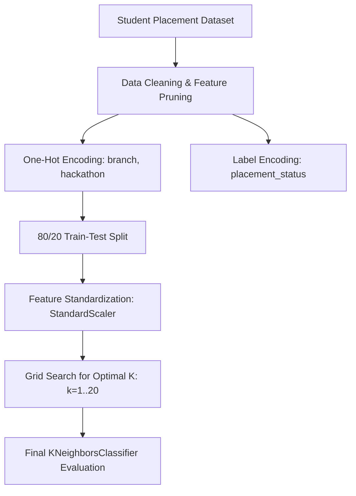

# 🎓 Student Placement Prediction with K-Nearest Neighbors (KNN)

[](https://www.python.org/)
[](https://scikit-learn.org/)
[](https://pandas.pydata.org/)
[](LICENSE)

A supervised machine learning classification project that models university student placement outcomes using the **K-Nearest Neighbors (KNN)** algorithm. Demonstrates feature engineering on multi-type student attributes, feature scaling, and empirical hyperparameter tuning for the optimal neighbor count ($K$).

---

## 📌 Project Overview

Predicting student placement outcomes helps academic advisors and students identify areas needing skill development before campus recruitment cycles. 

This project implements a complete, structured machine learning pipeline:
- **Data Preprocessing:** Handled missing values, feature selection, and categorical encoding.
- **Feature Scaling:** Applied `StandardScaler` to prevent high-magnitude features from dominating Euclidean distance calculations.
- **Hyperparameter Search:** Evaluated neighbor parameters $k \in [1, 20]$ to determine the optimal bias-variance tradeoff.
- **Model Evaluation:** Scored with accuracy, confusion matrices, and detailed classification reports.

---

## 📊 Dataset Schema

The dataset (`student_placement_dataset.csv`) contains multi-dimensional student records:

| Feature Name | Type | Description |
| :--- | :--- | :--- |
| `student_id` | Numerical | Identifier (dropped during preprocessing) |
| `age` | Numerical | Student age |
| `gender` | Categorical | Student gender |
| `branch` | Categorical | Academic department (CSE, IT, ECE, EEE, Mechanical) |
| `cgpa` | Numerical | Cumulative Grade Point Average |
| `internship_count` | Numerical | Number of completed internships |
| `project_count` | Numerical | Number of completed technical projects |
| `certifications_count`| Numerical | Number of technical certifications |
| `coding_skills_score` | Numerical | Standardized coding assessment score |
| `communication_skills_score` | Numerical | Communication assessment score |
| `soft_skills_score` | Numerical | Behavioral & soft skills score |
| `hackathon_participation` | Categorical | Prior hackathon participation (Yes / No) |
| **`placement_status`** | **Target** | Placement outcome (**Placed** / **Not Placed**) |

---

## 🏗️ Pipeline Architecture



---

## 🚀 Getting Started

### 1. Clone the Repository
```bash
git clone https://github.com/usha1101/Student_placement_KNN.git
cd Student_placement_KNN
```

### 2. Set Up Virtual Environment
```bash
# Windows
python -m venv venv
.\venv\Scripts\activate

# macOS / Linux
python3 -m venv venv
source venv/bin/activate
```

### 3. Install Dependencies
```bash
pip install -r requirements.txt
```

### 4. Execute the Pipeline
```bash
python Student_Placement_KNN.py
```

---

## 📂 Repository Contents

```text
Student_placement_KNN/
├── .gitignore                      # Python & cache ignore rules
├── README.md                       # Comprehensive project documentation
├── Student_Placement_KNN.py        # ML training and evaluation script
├── requirements.txt                # Python environment requirements
└── student_placement_dataset.csv   # Student placement benchmark dataset
```

---

## 👩‍💻 Author

**Ushashree M**  
- B.Tech Artificial Intelligence & Data Science, Reva University  
- GitHub: [@usha1101](https://github.com/usha1101)  

---

## 📄 License

This project is licensed under the [MIT License](LICENSE).
